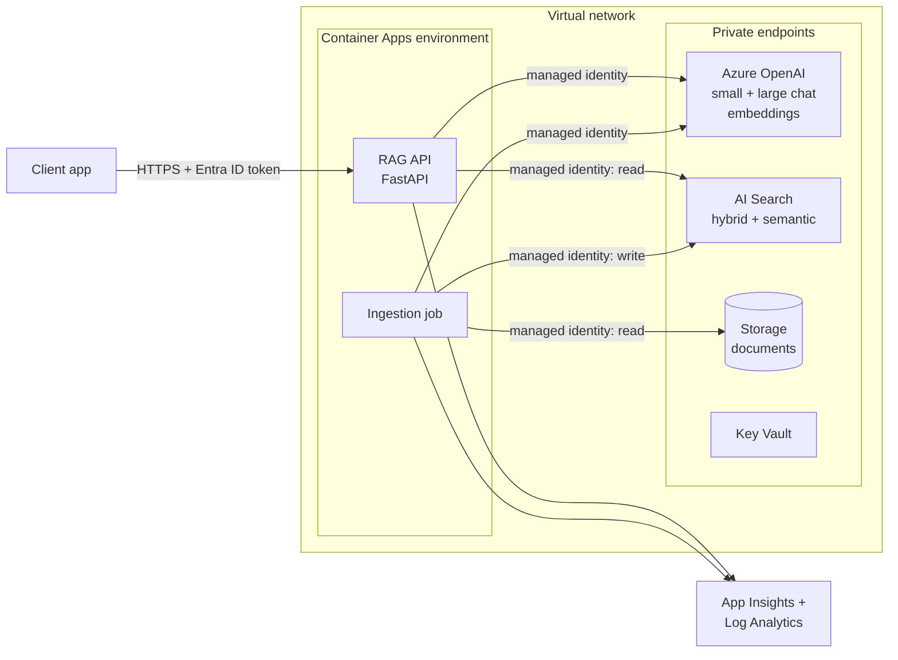

# secure-rag-azure

A production-minded reference architecture for **retrieval-augmented generation (RAG) on Azure**, with the same infrastructure in **Bicep** and **Terraform** and a small Python API.

Most RAG demos stop at "it answers questions." This one shows what has to be true before you can put an AI assistant in front of real customers:

- **Tenant isolation.** A customer can only retrieve their own documents, enforced server-side from their verified identity, with tests that prove it.
- **No keys anywhere.** Every service-to-service call uses managed identity and Microsoft Entra ID. API keys are disabled on Azure OpenAI, AI Search and Storage.
- **Private by default.** Azure OpenAI, AI Search, Storage and Key Vault have no public endpoints; the app reaches them through private endpoints.
- **Least privilege.** The API identity can only *read*; a separate ingestion identity can *write* the index.
- **Cost control.** Simple questions go to a small model, complex ones to a large model; context is kept small; token use is logged per tenant.

## Architecture



**Request flow:** the API reads the caller's tenant from the validated identity → embeds the question → runs hybrid (keyword + vector) search with semantic ranking, **filtered to the caller's tenant plus shared public content** → picks the small or large model → returns a grounded answer with citations.

**Ingestion flow:** the job reads documents from Storage → assigns each one to a tenant from its folder → chunks and embeds them → writes them to the index with a `tenantId` field.

```
documents/
├── public/                  shared content, visible to every tenant
│   └── policies/claims.md
└── tenants/
    ├── acme/                visible to tenant "acme" only
    │   └── contract.md
    └── globex/              visible to tenant "globex" only
        └── contract.md
```

Files outside these folders are skipped, so a misplaced file is never exposed (fail closed).

## What's in the repo

| Path | Contents |
|---|---|
| [`infra/bicep`](infra/bicep) | `main.bicep` + modules (network, monitoring, data, AI, apps, roles, private endpoints) and `main.bicepparam` |
| [`infra/terraform`](infra/terraform) | The same architecture with the `azurerm` provider, and `terraform.tfvars.example` |
| [`app`](app) | FastAPI service (`main.py`), ingestion job (`ingest.py`), shared logic (`core.py`), Dockerfile |
| [`tests`](tests) | Unit tests for tenant isolation, routing and chunking |
| [`docs/decisions.md`](docs/decisions.md) | Architecture decisions and the trade-offs behind them |
| [`samples`](samples) | Example documents in the expected folder layout |
| [`.github/workflows`](.github/workflows) | CI: Bicep build + lint, Terraform fmt + validate, Python tests |

## Deploy

You need an Azure subscription with access to Azure OpenAI, the Azure CLI, and Docker.

**1. Check model availability** in your region and update the model names/versions in `main.bicepparam` or `terraform.tfvars`:

```bash
az cognitiveservices model list -l eastus2 -o table
```

**2a. Deploy with Bicep**

```bash
az group create -n rg-secure-rag -l eastus2
az deployment group create -g rg-secure-rag \
  -f infra/bicep/main.bicep -p infra/bicep/main.bicepparam \
  -p deployerPrincipalId=$(az ad signed-in-user show --query id -o tsv) \
  -p allowedIpAddresses="['$(curl -s ifconfig.me)']"
```

**2b. Or deploy with Terraform**

```bash
cd infra/terraform
cp terraform.tfvars.example terraform.tfvars   # edit models, region, your IP
terraform init
terraform apply
```

**3. Build and push the app image, then point the apps at it**

```bash
REGISTRY=<registryLoginServer output>
az acr build -r ${REGISTRY%%.*} -t secure-rag:1.0 app/
```

Redeploy with `containerImage=$REGISTRY/secure-rag:1.0` and `useCreatedRegistry=true` (Bicep), or `container_image` and `use_created_registry = true` (Terraform).

**4. Upload documents and run ingestion**

```bash
az storage blob upload-batch --auth-mode login \
  --account-name <storageAccountName> -d documents -s samples/documents
az containerapp job start -n <ingestJobName> -g rg-secure-rag
```

**5. Turn on authentication.** Enable [Container Apps built-in authentication](https://learn.microsoft.com/azure/container-apps/authentication) with your Microsoft Entra ID app registration and require authentication. The API reads the tenant from the `tenant_id` claim (configurable with `TENANT_CLAIM_TYPE`) and rejects requests without it.

```bash
curl -X POST https://<apiUrl>/ask \
  -H "Authorization: Bearer <token>" -H "Content-Type: application/json" \
  -d '{"question": "What is the deadline to file a claim?"}'
```

## Run locally

```bash
cd app
pip install -r requirements.txt
az login   # DefaultAzureCredential uses your Azure CLI login
export AZURE_OPENAI_ENDPOINT=... AZURE_SEARCH_ENDPOINT=... \
       CHAT_SMALL_DEPLOYMENT=chat-small CHAT_LARGE_DEPLOYMENT=chat-large EMBEDDING_DEPLOYMENT=embedding \
       ALLOW_DEV_AUTH=true DEV_TENANT_ID=acme
uvicorn main:app --reload
```

Local runs need network access to the private services (VPN, a jump box, or temporarily allowing your IP).

Tests need no Azure account:

```bash
pip install pytest -r app/requirements.txt
pytest
```

## Cost

Rough idle cost is driven by AI Search (Basic tier) and the private endpoints; Container Apps scales to zero. Model usage is pay-per-token. Use the [Azure pricing calculator](https://azure.microsoft.com/pricing/calculator/) for your region and volume, and remove everything with `az group delete -n rg-secure-rag` or `terraform destroy` when you're done.

## Production checklist (beyond this reference)

- **AI gateway:** put Azure API Management in front of the models for retries, load-balancing across deployments, per-tenant quotas and token metering.
- **Evaluation in CI:** a test set of real questions with expected answers, run on every prompt, model or retrieval change, blocking releases that score lower.
- **Content safety:** review content filter settings and add prompt-injection detection on user input and retrieved documents.
- **Document formats:** add Azure AI Document Intelligence for PDFs and Office files.
- **Registry:** use ACR Premium with a private endpoint, and image signing.
- **Resilience:** a second region for business-critical workloads.

## License

MIT — see [LICENSE](LICENSE).
